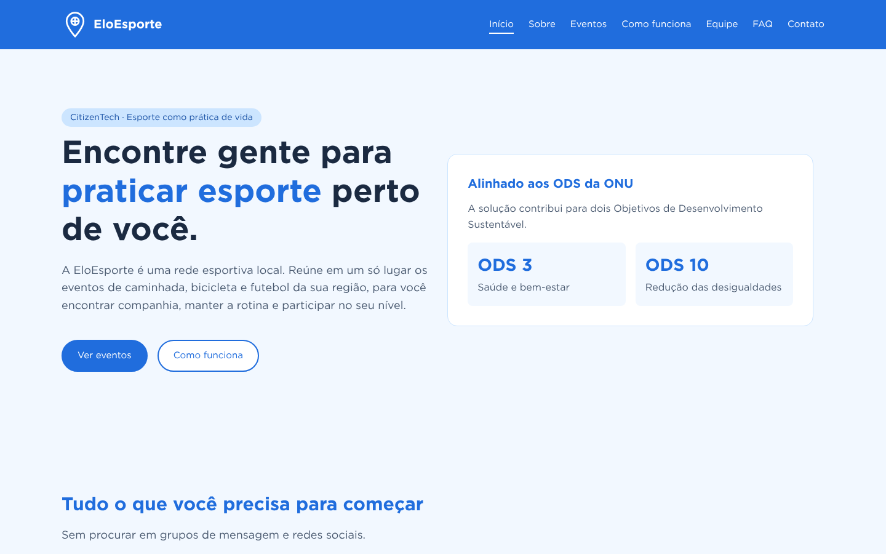
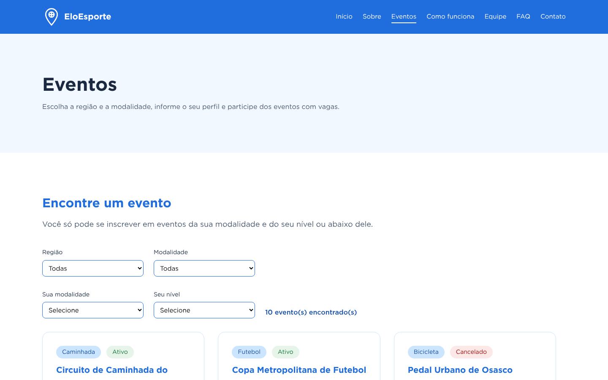
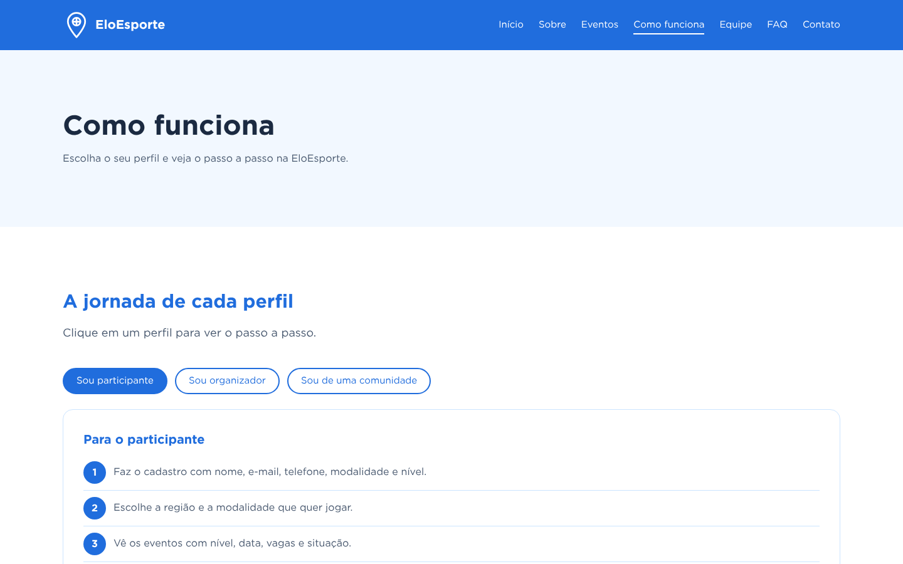
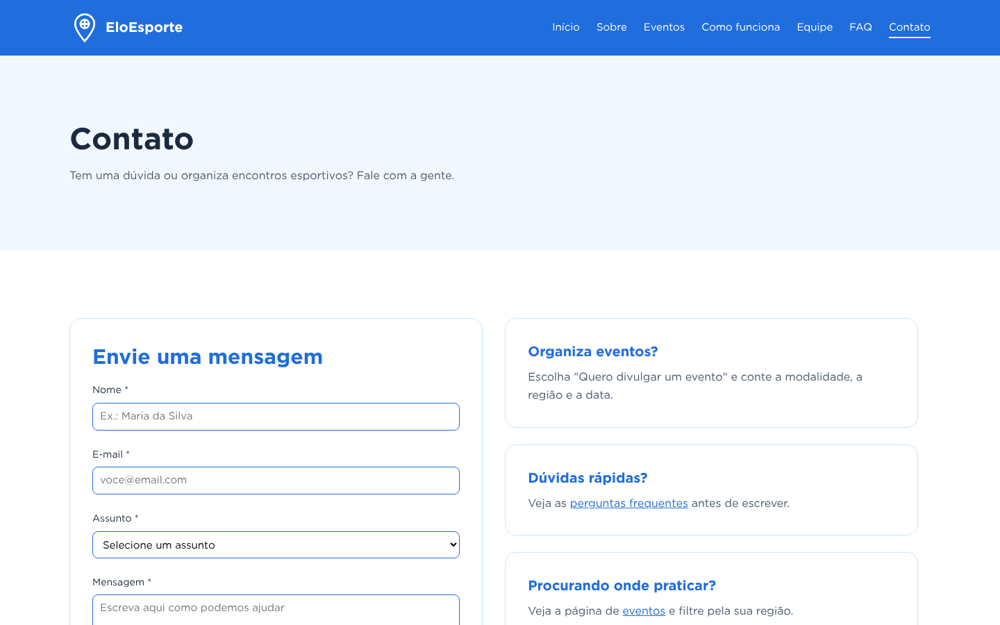
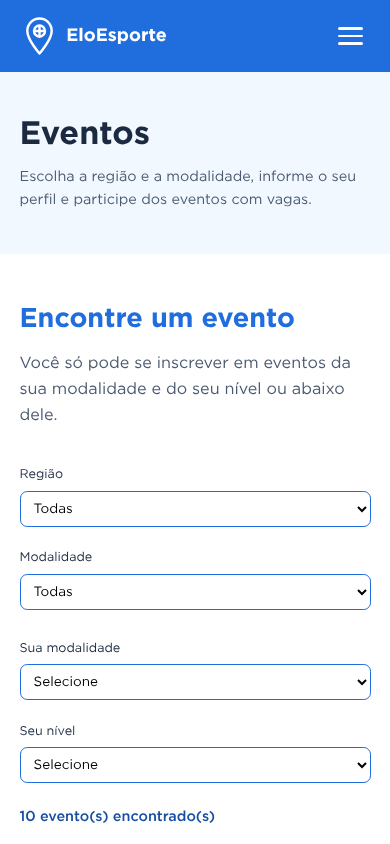

<h1 align="center">EloEsporte</h1>

<p align="center">
  Encontre lugares e eventos para jogar perto de você.<br />
  Global Solution FIAP 2026 · CitizenTech · Equipe <strong>NextLevel</strong> (1TDSPT)
</p>

<p align="center">
  📁 <a href="LINK_DO_REPOSITORIO"><strong>Repositório no GitHub</strong></a>
</p>

---

## 📌 Sobre o projeto

**Problema:** muitas pessoas têm dificuldade para encontrar atividades esportivas perto de casa, pessoas com interesses parecidos e encontros compatíveis com a sua região, rotina e nível. As informações ficam espalhadas em grupos de WhatsApp, redes sociais e comunidades.

**Solução:** a EloEsporte é uma rede esportiva local que conecta pessoas, locais e encontros de caminhada, bicicleta e futebol. O participante escolhe a região e a modalidade, vê os eventos com nível exigido, data, vagas e situação (ativo, encerrado ou cancelado) e se inscreve apenas nos eventos ativos da sua modalidade e do seu nível.

**Proposta de valor:** transformar o interesse pela prática esportiva em participação real e presencial, aproximando pessoas e fortalecendo as comunidades locais por meio do esporte.

**ODS:** 3 (Saúde e bem-estar) e 10 (Redução das desigualdades).

---

## ✨ Funcionalidades

- **Menu hambúrguer** em telas menores;
- **Filtro de eventos** por região e modalidade, com contador de resultados (evento `change`);
- **Inscrição em eventos:** confere a modalidade, o nível do participante e as vagas, desconta a vaga e mostra a confirmação (evento `click`);
- **Abas de perfil** (participante, organizador e comunidade) com o passo a passo de cada um (evento `click`);
- **Formulário de contato** com validação em JavaScript: campos obrigatórios, formato de e-mail, destaque do campo com erro e mensagem de sucesso (eventos `submit` e `input`);
- **FAQ** em acordeão com `details` e `summary`;
- **Layout responsivo** testado em 390×844, 768×1024 e 1440×900.

---

## 🛠️ Tecnologias

| Tecnologia | Uso no projeto |
|---|---|
| HTML5 | Estrutura semântica das 7 páginas |
| CSS3 | Variáveis, Flexbox, medidas em rem e media queries |
| JavaScript | Menu, filtro, inscrição, abas e validação do formulário |
| Git e GitHub | Versionamento e trabalho em equipe |

Sem frameworks ou bibliotecas externas. Fonte: **Gotham** (arquivos locais).

---

## 📂 Estrutura de pastas

```
eloesportes/
├── index.html
├── sobre.html
├── eventos.html
├── como-funciona.html
├── integrantes.html
├── faq.html
├── contato.html
├── README.md
├── css/
│   └── style.css
├── js/
│   └── script.js
└── assets/
    ├── fonts/
    ├── icons/
    └── images/
```

---

## 🖼️ Imagens

| Página inicial | Eventos |
|---|---|
|  |  |
| **Como funciona** | **Contato** |
|  |  |

<p align="center"></p>

---

## 👥 Autores

| Nome | RM | Turma | GitHub | LinkedIn |
|---|---|---|---|---|
| Carlos Eduardo Alves Oliveira | 575518 | 1TDSPT | [cadubrrj-beep](https://github.com/cadubrrj-beep) | [LinkedIn](https://www.linkedin.com/in/caduoliveirarj/) |
| Rafael Silva de Jesus | 574559 | 1TDSPT | [RafaJesus3](https://github.com/RafaJesus3) | [LinkedIn](https://linkedin.com/in/rafaeljesus01) |
| Nicolas David Magalhães | 576054 | 1TDSPT | [Nicolasdmagalhaes](https://github.com/Nicolasdmagalhaes) | [LinkedIn](https://www.linkedin.com/in/nicolas-david-magalhaes-0b398742a/) |
| Carlos Henrique Carvalho de Lima | 575083 | 1TDSPT | [CarlRickCliman](https://github.com/CarlRickCliman) | [LinkedIn](https://www.linkedin.com/in/carlos-henrique-carvalho-de-lima-606b033bb/) |
| Leonardo Souza da Conceição | 575060 | 1TDSPT | [LeonardoSC-eng](https://github.com/LeonardoSC-eng) | [LinkedIn](https://www.linkedin.com/in/leonardo-souza-da-concei%C3%A7%C3%A3o/) |

---

## 📬 Contato

Use o formulário da página [Contato](contato.html) ou fale com qualquer integrante pelo LinkedIn.
